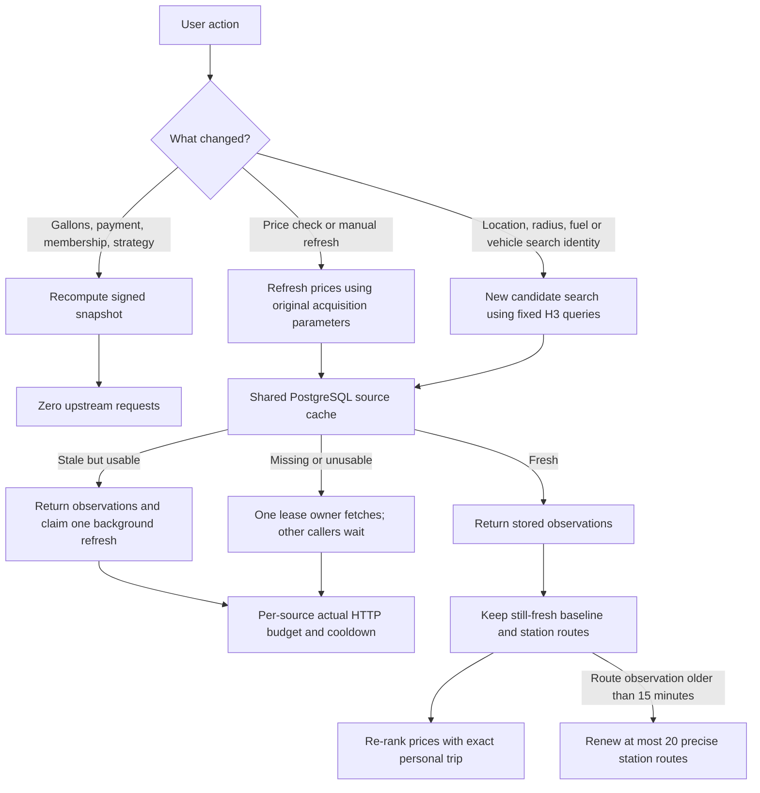

# GasWise search and storage architecture

The recommended implementation combines shared public observations, private
client-held search snapshots, and independently expiring route results. PostgreSQL
runs in the existing production `postgres` container; Redis is not required.

## Responsibilities

| Layer | Stored state | Scope and expiry |
|---|---|---|
| PostgreSQL source query cache | Public GasBuddy/Maps/Waze response DTOs, original timestamps, coverage evidence | Shared across users/processes; fresh for 15 minutes, stale fallback up to one hour |
| PostgreSQL station identities | Source station IDs, verified canonical mapping, public name/address/location | Retained when a quote expires; mapping checked against current station coordinates before reuse |
| PostgreSQL current quotes | Separate source, grade, payment and purchase conditions; original report/fetch dates | Reported prices expire after 72 hours; unknown report time after six hours from fetch |
| PostgreSQL coordination | Refresh lease, actual HTTP request counters, source cooldown | Shared by instances; short transactions and expiring leases |
| Process-memory routes | Digested exact trip key, provider route totals | Existing five-minute cache; no visitor route endpoints stored in PostgreSQL |
| Signed browser snapshot | Exact personal search, vehicle profile, candidate observations, baseline and station routes, acquisition parameters | Client held, ten-minute signature lifetime; no shared ranking or visitor history |
| Browser preferences/identity | User settings and existing protected vehicle identity state | Existing local storage/encryption design; no transfer to the pricing DB |

## User actions

A source may require a whole-area query to obtain fresh prices. The price-refresh
endpoint is a separation of application responsibilities, not a claim that the
upstream providers expose a cheaper price-only endpoint. New stations discovered
by a refresh participate using explicitly labelled geometric route estimates
until precise routing is requested or the bounded route shortlist is renewed.

## Geography and coverage

The primary viewport uses a fixed H3 resolution-8 centre. Radius is rounded to a
500-metre bucket and enlarged by a fixed margin sufficient for the cell boundary.
Caller-specific displacement never enters the upstream query radius/cache key.
Maps expansion uses existing H3 query points and radius steps. The personal origin
and route endpoints remain exact. Results are filtered against the real personal
search circle and its explicit soft boundary.

The proven-disk coverage algorithm consumes cached or newly obtained tile responses
identically and queries only remaining unproven areas within its request budget.
Nearby callers can share the same tile response, including across main-cell
boundaries. A full capped page or GasBuddy cursor retains partial coverage status.
There is no exhaustive-coverage claim and no inference that arbitrary historical
quote rows prove a region has been completely searched. Generic reuse of larger
partial-area queries would be unsafe and is deliberately not part of the cache.

## Freshness, budgets and retention

Fifteen minutes is the conservative starting price refresh interval. The operator
can lower `GASWISE_PRICING_CACHE_FRESH_SECONDS` to 300 after observing request
counts and rejection rates. Price refresh is demand driven: inactive regions do
not poll. Browser checks remain at the existing visible-tab cadence; they usually
read shared cached data. Manual refresh cannot bypass the shared window.

Query check time, source report time, signed-snapshot assembly time and route
observation time are separate clocks. Repeatedly fetching a four-day-old report
cannot renew it. Query-time filtering removes expired prices before the hourly
physical cleanup. Stable station records are not deleted just because their last
price aged out. Per-source/payment/octane/membership provenance remains intact.

Request budgets are charged per actual HTTP call, including pagination, details,
Waze login and Maps directions. Rejections cool the source across all workers.
Database failure is fail-closed for acquisition/budgeting. An existing browser
snapshot remains visible after a refresh failure; the service does not represent
its old prices as newly fetched. Route renewal failures retain an explicitly
labelled older direct baseline and use geometric station-detour estimates.

## API stages

- `POST /v1/smart/search`: new area/vehicle/fuel search; shared source acquisition
  and an initial maximum of 20 precise routes when geometric fallback is enabled.
- `POST /v1/smart/refresh-prices`: verifies the held snapshot, preserves its original
  provider acquisition parameters and vehicle configuration, refreshes shared
  observations, and retains routes younger than 15 minutes.
- `POST /v1/smart/rerank`: recomputes personal eligibility and costs with zero
  upstream calls.
- `POST /v1/smart/routes`: explicit bounded precision expansion, without price
  reacquisition.

Snapshot expiration or a change to the personal search identity starts a new
signed transaction. All responses remain `Cache-Control: no-store`; public DB
reuse does not turn personal API responses into a CDN or cross-user cache.

## Delivery evidence

The repository includes deterministic regression tests and an opt-in integration
test against the existing PostgreSQL. Deployment acceptance separately requires:
DB configuration in the private server `.env`, immutable backend/frontend image
publication, a staging check with real data, and production repeat-search proof.
Implementation or fixture-based DB verification alone is not production acceptance.

### Current verification on 2026-10-13

- Backend regression: 595 passed; the existing-DB integration is opt-in and is
  skipped in the ordinary suite when its private connection is not configured.
- Frontend: 75 tests passed; production build and six gateway tests passed.
- Existing PostgreSQL integration has passed with independent pools and restart
  reuse. It uses isolated fixture IDs and does not establish live source coverage.
- Live DTLA price acquisition used real GasBuddy, Maps-web and Waze data with two
  GasBuddy pages, three Maps queries and routing disabled. All three sources were
  `ok`; the response contained 66 quote records (not 66 unique physical stations).
- First query: 24.66 seconds. A second query with a slight location change, changed
  gallons and a forced-refresh flag took 2.50 seconds and made zero upstream source
  requests, with six cache hits. This ran locally through SSH to the existing
  production PostgreSQL; it is not production-site latency or full-radius proof.
- Production release status is verified separately against the running immutable
  image tag and HTTP responses. No database container was created; the dedicated
  logical database and login are on the existing PostgreSQL.
